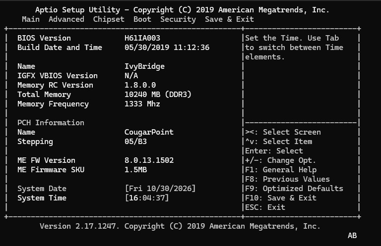
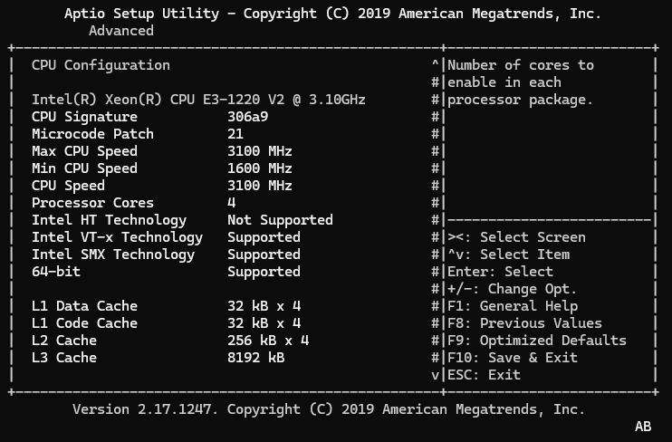
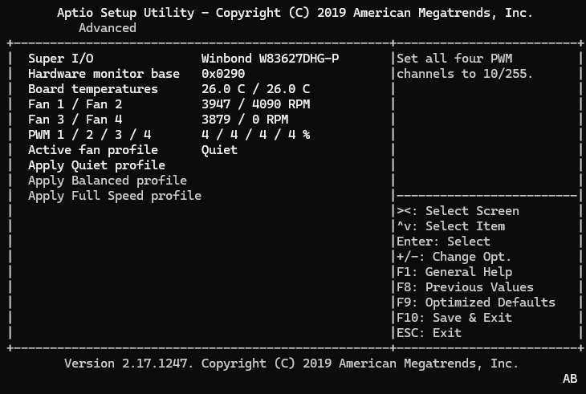

# Nomadix FW-7582 Ivy Bridge firmware

This repository documents an experimental firmware port for the Lanner
FW-7582 industrial appliance. The original board firmware supported Sandy
Bridge processors only. The resulting image boots an Ivy Bridge Xeon E3-1220
v2 and restores the board-specific serial console, Winbond hardware monitor,
fan controls, front-panel display, SMBIOS identity, and AC power-loss policy.

The firmware is not a single vendor BIOS. It is a deliberately constructed
hybrid with a reproducible provenance described below.

## Screenshots

### Ivy Bridge platform and ME8



### Intel Xeon E3-1220 v2



### Nomadix hardware monitor and fan profiles



## Final image at a glance

The current hardware-tested quiet image is Stage 4GH:

```text
output/onda-exact/TEST_ONLY_stage4gh_quiet-final.bin
SHA-256 3D843DADDBB95664D51341B76BA8AD8E707F26FC2D48747AEAA61A895AA0FB42
```

Stage 4GG is the equivalent diagnostic build with serial status markers.
Detailed build hashes, hardware results, and recovery instructions are in
[FLASH-ONDA.txt](output/onda-exact/FLASH-ONDA.txt).

PXE support is available as a separate first-port-only build line:

```text
Hardware-tested diagnostic:
output/onda-exact/TEST_ONLY_stage4go_notified-single-port-pxe.bin
SHA-256 EB153383EC033EC12D6FDD579C68F09ABB1094A5352BC6D9C8CAD9904AF37BE4

Quiet successor, structurally validated:
output/onda-exact/TEST_ONLY_stage4gp_quiet-single-port-pxe.bin
SHA-256 1452E92B27AC2244B59164DBDF111BF9D15EDE08EB3EB54B4DA1F18E6FED7B79
```

See [UEFI PXE support](#uefi-pxe-support) for the supported port, Intel input,
Setup policy, limitations, and safety notes. The original Stage 4GH remains
the hardware-tested quiet non-PXE release.

The `.bin` file is the complete 8 MiB SPI flash image. The similarly named
`.efi` file is only the embedded Nomadix DXE driver and is **not** a flashable
BIOS image.

## Handing the firmware to another owner

### Simple hand-off: an already built image

There is no installer executable. For a specific appliance, hand over:

1. one appropriate complete image:
   - `TEST_ONLY_stage4gh_quiet-final.bin` for the quiet non-PXE release;
   - `TEST_ONLY_stage4go_notified-single-port-pxe.bin` for hardware-tested PXE
     diagnostics;
   - `TEST_ONLY_stage4gp_quiet-single-port-pxe.bin` for the quiet PXE
     successor after local hardware verification;
2. the corresponding SHA-256 value;
3. [onda-stage4c.layout](output/onda-exact/onda-stage4c.layout);
4. the recovery and test notes in
   [FLASH-ONDA.txt](output/onda-exact/FLASH-ONDA.txt).

The generated images are intentionally ignored by Git, so a fresh GitHub
checkout does not contain either `.bin`. They must be transferred separately
after confirming that doing so is permitted for the locally obtained donor
firmware.

Stage 4GH is the quiet final image:

```text
SHA-256 3d843daddbb95664d51341b76ba8ad8e707f26fc2d48747aeaa61a895aa0fb42
```

It is structurally validated and hardware-tested on the FW-7582: the machine
POSTs, boots, and displays `HELLO THERE` / `FOXNODIX` on the front-panel PLCM.
Stage 4GG remains useful when internal Nomadix diagnostic output is required.

### Installing on a stock FW-7582

The recipient should treat this as an SPI-chip recovery operation, not as a
normal BIOS update:

1. Use a known-working 3.3 V external/ISP SPI programmer.
2. Read the original chip at least twice and confirm that the two 8 MiB reads
   have the same SHA-256.
3. Keep one untouched backup away from the working directory.
4. Verify the candidate image size and its published SHA-256.
5. Write the complete 8 MiB image. A stock FW-7582 needs the converted ME8
   region as well as the new BIOS boot stack.
6. Before the first boot, read the complete chip back and confirm that it is
   byte-identical to the candidate image.
7. Disconnect the ISP programmer before applying normal power.
8. Keep the original dump and programmer available until cold boot, reboot,
   Setup, fan fail-safe, PLCM, and AC power-loss behavior have all passed.

An example for the Raspberry Pi `linux_spi` setup used during development is:

```sh
flashrom \
  -p linux_spi:dev=/dev/spidev0.0,spispeed=1000 \
  -c "W25Q64BV/W25Q64CV/W25Q64FV" \
  -r fw7582-original-read1.bin

flashrom \
  -p linux_spi:dev=/dev/spidev0.0,spispeed=1000 \
  -c "W25Q64BV/W25Q64CV/W25Q64FV" \
  -r fw7582-original-read2.bin

sha256sum fw7582-original-read1.bin fw7582-original-read2.bin

flashrom \
  -p linux_spi:dev=/dev/spidev0.0,spispeed=1000 \
  -c "W25Q64BV/W25Q64CV/W25Q64FV" \
  -w TEST_ONLY_stage4gh_quiet-final.bin

flashrom \
  -p linux_spi:dev=/dev/spidev0.0,spispeed=1000 \
  -c "W25Q64BV/W25Q64CV/W25Q64FV" \
  -r stage4gh-readback.bin

sha256sum stage4gh-readback.bin
```

The final read-back must match the Stage 4GH full-image hash before the first
boot. Programmer selection, voltage, chip package, and isolation from board
power must be checked for the actual hardware rather than copied blindly from
this example.

For a machine that already contains the same Stage 4C-or-newer
descriptor/ME8/NVRAM base, only the complete boot-stack region may be updated:

```sh
flashrom \
  -p linux_spi:dev=/dev/spidev0.0,spispeed=1000 \
  -c "W25Q64BV/W25Q64CV/W25Q64FV" \
  --layout onda-stage4c.layout \
  --image onda_bootstack \
  --write TEST_ONLY_stage4gh_quiet-final.bin
```

Do not use the region-only command on an untouched Lanner ME7 image.

### Building instead of transferring the image

The exact Stage 4GH image is reproducible from a clean checkout plus the
external inputs pinned in [build-inputs.json](build-inputs.json). Donor
firmware, machine dumps, generated images, Microsoft build products, and
vendor tools remain intentionally absent from Git.

The build has a mandatory hardware boundary:

1. `py -3 tools/build_lanner_me8_stage1.py` creates the exact verified Stage 1
   image from the original Lanner dump, ASRock donor, and local Intel FITC.
2. Stage 1 must be flashed, booted once with the supported Sandy Bridge CPU,
   and read back as `post-stage1-boot-readback.bin`. Intel ME runtime data and
   active NVRAM are initialized by real hardware and must not be fabricated.
3. `py -3 tools/build_release.py --check-only` verifies every external input
   and build tool.
4. `py -3 tools/build_release.py` rebuilds the exact 22-step release chain and
   requires the final Stage 4GH SHA-256 to match.

The historical Angxun X7-VB Stage 2 experiments are not part of this release
path. Stage 4C erases the entire range that contained their only contribution.

See [BUILDING.md](BUILDING.md) for the supported Stage 4GH rebuild, donor
requirements, the complete construction outline, and a detailed methodology
for adapting the work to another motherboard.

## UEFI PXE support

The FW-7582 has six onboard Intel 82583V controllers with PCI ID `8086:150C`.
The matched ONDA firmware already contains SNP, MNP, DHCP, IPv4/IPv6, MTFTP,
UDP, TCP, and UEFI PXE Base Code drivers, but its hardware-specific UNDI
driver targets Realtek controllers.

The PXE build replaces the existing `RtkUndiDxe` executable with Intel
PRO/1000 UEFI x64 PCI-E driver 9.9.25, file `E9925X3.EFI`, obtained from the
official [Intel Ethernet Connections Boot Utility, Preboot Images, and EFI
Drivers](https://www.intel.com/content/www/us/en/download/15755/intel-ethernet-connections-boot-utility-preboot-images-and-efi-drivers.html).
The Intel package and binary are not redistributed by this repository.

Pinned input:

```text
PREBOOT\APPS\EFI\EFIx64\E9925X3.EFI
Size 394560 bytes
SHA-256 07122889AB1286F263286C1F8D07F8BE3AEAD8323882CB09E7CADE454D96E562
```

### Supported PXE policy

UEFI PXE is intentionally limited to:

```text
Physical port: first onboard Ethernet port
PCI location:  0000:01:00.0
MAC address:   00:50:E8:02:C3:3E
Protocol:      IPv4 PXE
```

The other five ports are deliberately not UEFI PXE-capable. Initializing all
six ports added about five seconds per port, created six indistinguishable
`UEFI: Network Card` entries, and exposed incompatible Intel HII pages as
`<null string> - MAC`. Limiting preboot networking to one port avoids those
delays and ambiguous entries. OpenWrt is unaffected and continues to expose
all six controllers through `e1000e`.

Required Setup policy:

```text
Network Stack       Enabled
IPv4 PXE Support    Enabled
IPv6 PXE Support    Disabled
```

The old AMI BDS generates the description `UEFI: Network Card`; it does not
include IPv4, port number, or MAC address. With only one preboot-capable port,
that generic entry is unambiguous.

Stage 4GO is the hardware-tested diagnostic image. Stage 4GP compiles out only
the `[NOMADIX-4G...]` network diagnostics and retains the same single-port
policy. Intel adapter HII packages are removed after initialization because
the old AMI browser cannot render their dynamic labels correctly and their
configuration callbacks include NIC EEPROM write operations.

Do not use Intel BootUtil to update NIC NVM. Ordinary UNDI/PXE initialization
is expected to read NVM, not rewrite it, but the Intel driver contains explicit
configuration and `NVDATA_WRITE` paths. Do not save Intel adapter
configuration. For byte-level verification, capture each NIC EEPROM with
Linux `ethtool -e` before and after testing.

Stage 4GN is unsafe and must never be flashed. It can be identified by
SHA-256 `1516D1E92E4D98D723BDC9B814AB3E367091AD9C7EB9B7D095ED92C4B12B59E6`.
It returned `EFI_NOT_FOUND` before Intel Driver Binding was installed and
stalled DXE/BDS. Stage 4GO and 4GP use protocol notification and do not have
that dispatch-order failure.

Complete bring-up history, recovery notes, and intermediate-stage results are
in [FLASH-ONDA.txt](output/onda-exact/FLASH-ONDA.txt). Reproducible PXE build
commands are in [BUILDING.md](BUILDING.md).

## Final flash layout and provenance

| Flash range | Origin | Contents and role |
|---|---|---|
| `0x000000-0x000FFF` | Lanner FW-7582 | Original Intel flash descriptor, region layout, access permissions, and board flash parameters. |
| `0x001000-0x3FFFFF` | ASRock H61M-ITX 2.00 + Lanner configuration | Intel ME 8.0.13.1502, rebuilt for the Lanner image. The original Lanner descriptor was restored byte-for-byte. Lanner and ASRock used matching FCIM/ICC clock configuration for all 89 comparable fields; the Lanner LAN power-well value was retained. |
| `0x400000-0x41FFFF` | Lanner FW-7582 runtime image | Original lower BIOS/NVRAM area and machine-specific variable state used as the persistent base. |
| `0x420000-0x57FFFF` | Deliberately erased | Filled with `0xFF` so the obsolete Lanner Sandy Bridge DXE FV cannot be discovered before the matched ONDA stack. |
| `0x580000-0x75FFFF` | ONDA H61ITX | Matched ONDA Aptio DXE/boot stack, including the nested FV contract expected by the ONDA Ivy PEI/DXE IPL implementation, AMI Setup/TSE, BDS, ACPI, and platform drivers. |
| `0x760000-0x7FFFFF` | ONDA H61ITX, modified | Exact-layout 640 KiB Ivy Bridge SEC/PEI volume at physical address `0xFFF60000`. `WdtAppPei` was disabled during bring-up. |
| ONDA `ITEPOWERFAILDXE` PE32 section | Nomadix | Replaced by the cumulative freestanding x86-64 DXE driver. The original FFS GUID and TRUE/END dependency section are retained. |
| ONDA `RtkUndiDxe` PE32 and UI sections, PXE stages | Intel official Preboot driver | Replacement with `E9925X3.EFI` 9.9.25 for the onboard Intel 82583V (`8086:150C`). The existing automatically dispatched DXE FFS container is retained. |
| Two ONDA microcode FFS files | Intel official microcode | CPUID `306A9` was updated from revision `0x1C` to official Intel revision `0x21`; duplicate `306A9` records were removed. Other records remain unchanged. |

## What comes from each motherboard firmware

### Lanner FW-7582

The original Lanner dump remains the machine-specific foundation:

- Intel flash descriptor and access policy;
- original board flash layout;
- active NVRAM base and machine-specific state;
- original ME7 configuration used as the reference for the ME8 conversion;
- Super-I/O and board behavior used as the hardware reference:
  - Winbond W83627DHG-P-compatible ID/revision `B0/73`;
  - COM1 at `0x3F8`, IRQ 4;
  - COM2 at `0x2F8`, IRQ 3;
  - hardware monitor at `0x290`;
  - parallel front-panel display at `0x378`.

The original Lanner executable PEI and DXE stacks are not used in the final
image because they are Sandy Bridge-era and are incompatible with the matched
ONDA Ivy boot flow.

Several individual Lanner modules were experimentally transplanted into the
ONDA stack but are not part of the final image:

| Stage | Lanner module | Result |
|---|---|---|
| 4D1 | `OEMDXE` | Booted, but produced no useful board-function change. |
| 4D2 | `CRBDXE` | Booted, but did not restore UART or fan behavior. |
| 4D3 | `ACPI` | Changed ACPI table composition but did not restore the missing board functions. |
| 4D4 | `CspLibDxe` | Booted, but did not restore UART or fan behavior. |
| 4E1 | `AmiBoardInfo` | Incompatible as a standalone transplant; caused a no-POST hang. |

### ONDA H61ITX

ONDA supplies the matched Ivy Bridge boot environment used by the final
image:

- SEC and PEI core;
- Ivy-compatible MemoryInit/MRC;
- CPU, PCH, and System Agent PEIMs;
- ME8 HECI/UMA PEI support;
- DXE IPL and the nested FV layout it expects;
- DXE core and the bulk of the Aptio DXE drivers;
- AMI Setup/TSE and BDS;
- ACPI table generation;
- the original serial terminal and redirection components;
- Sandy/Ivy microcode containers, later updated with official Intel `306A9`
  revision `0x21`.

The visible serial POST line `ONDA H61ITX` comes from an independent ONDA/AMI
BDS OEM source. It is intentionally left unchanged because patching compressed
BDS code for a cosmetic line adds risk without functional benefit.

ONDA also provided Setup forms whose board-specific policy callbacks did not
match the Lanner hardware. The Nomadix DXE driver compensates for these gaps
instead of transplanting more incompatible vendor modules.

The donor motherboard page and its archived firmware are available from
[The Retro Web: ONDA H61 ITX Ver 1.0](https://theretroweb.com/motherboards/s/onda-h61-itx-ver-1-0).
The build expects the 4 MiB `ONDA H61ITX01.BIN` image with SHA-256:

```text
5F5E0AB78A2D736F443940F6691C0BA5EACD2D6DADAAC1A5284B5B3F32E20E72
```

The page is linked as an acquisition reference; the donor image is not copied
into this repository.

### ASRock H61M-ITX 2.00

ASRock supplies the ME8 basis used in the final image:

- Intel ME 8.0.13.1502, 1.5 MiB Consumer SKU;
- Cougar Point/Panther Point support appropriate for H61 B3;
- clock/ICC configuration matching the Lanner ME7 platform data;
- an explicit Ivy Bridge-era firmware lineage used to validate donor
  suitability.

ASRock PEI and DXE modules are not used in the final Stage 4GH boot stack.
The archived donor board and BIOS are available from
[The Retro Web: ASRock H61M-ITX](https://theretroweb.com/motherboards/s/asrock-h61m-itx).
The ASRock image is an ME source and configuration reference; it is not
directly flashed to the Lanner.

### ASUS P8H61 4306

ASUS was an early Ivy Bridge donor used during feasibility work:

- supplied a compact 448 KiB Ivy PEI FV suitable for early hybrid tests;
- supplied Ivy MemoryInit, CPU policy/init, PCH/SA init, HECI PEI support,
  and Sandy/Ivy microcodes;
- ASUS-specific `SIOBasicIOPei`, `AsusHeaderPEI`, `BBVideo`, `ProjectPEI`,
  and vendor raw data were removed;
- Lanner `CRBPEI` and `SMBiosFlashData` were inserted into that experimental
  hybrid.

That ASUS hybrid was superseded by the exact matched ONDA SEC/PEI/DXE stack.
No ASUS executable module is intentionally present in final Stage 4GH.

### Angxun ANGTHUMB XLZ X7-VB V2.0

The previously ambiguous `x7-vb.bin` belongs to the
[Angxun ANGTHUMB XLZ X7-VB V2.0](https://theretroweb.com/motherboards/s/angxun-angthumb-xlz-x7-vb-v2-0-h61),
not to Biostar or Jetway. It contains the matching embedded names
`X7VB1001.rom` and `X7VB1001`.

This particular BIOS build uses a later or rebranded SMBIOS identity:

```text
System manufacturer:  AISURIX
System product:       H61
Baseboard manufacturer: AISURIX
Baseboard product:      H61 Motherboard
Baseboard version:      V2.0
```

The firmware structure and filename identify the X7-VB donor, while the SMBIOS
strings show that the same H61 reference design was also shipped or updated
under the AISURIX identity. Its SHA-256 is:

```text
3155D0D47686ABF243A26EC50FE1A5DC8950CC885D3EE906A8C5B80ED30B846A
```

It supplied an Ivy-era microcode package and several experimental SEC/PEI
combinations during Stages 2A-2H. Only Stage 2A booted, because it retained the
original Lanner SEC/PEI and changed the DXE microcode package. Stage 4C later
erases `0x420000-0x57FFFF`, including that Stage 2A change, before installing
the ONDA boot stack. The Angxun image is therefore historical evidence only
and is not required to reproduce Stage 4GH.

### Intel

The final Ivy microcode is not taken from a motherboard donor:

- CPUID `306A9`;
- revision `0x21`;
- date `2019-02-13`;
- platform flags `0x12`;
- sourced from the official Intel microcode distribution;
- included only when the corresponding Intel redistribution license is
  available to the build.

## Newly written Nomadix code

The cumulative custom driver under [firmware/](firmware/) was written for this
port. It does not transplant a Lanner or ONDA executable. Its major functions
are:

- PCH LPC decode initialization for COM1, COM2, HWM, and LPT;
- Winbond W83627DHG-P logical-device initialization;
- fail-safe PWM initialization at 100 percent;
- native EFI Serial I/O, Text Output, Text Input, and Text Input Ex support;
- corrected serial escape-sequence handling and ANSI Setup rendering;
- standalone `Nomadix Hardware Monitor` HII formset;
- live temperatures, fan RPM, and PWM display;
- Quiet, Balanced, and Full Speed fan profiles;
- fan-profile read-back verification and fallback to full speed;
- persistent fan profile stored in a dedicated Nomadix UEFI variable;
- FOXNODIX SMBIOS branding through `EFI_SMBIOS_PROTOCOL`;
- LPT and front-panel PLCM initialization;
- `HELLO THERE` / `FOXNODIX` PLCM boot message;
- functional `Restore AC Power Loss` policy by translating ONDA Setup offset
  `0x2D3` to PCH `GEN_PMCON_3.AFTERG3_EN`;
- compile-time quiet mode that suppresses Nomadix development diagnostics
  while preserving AMI POST, Setup, and boot-loader serial output.

The most relevant final-stage sources are:

- [stage4f2 platform initialization](firmware/stage4f2/nomadix_platform_dxe.c)
- [stage4fy HII and fan implementation](firmware/stage4fy/nomadix_w83627_hii_formset_dxe.c)
- [stage4gb SMBIOS branding](firmware/stage4gb/nomadix_foxnodix_smbios_branding_dxe.c)
- [stage4gc PLCM implementation](firmware/stage4gc/nomadix_plcm_boot_message_dxe.c)

OpenWrt runtime integration is available as a feed-ready package under
[`openwrt/nomadix-platform`](openwrt/nomadix-platform). It provides a
fail-safe `procd`-supervised fan daemon, UCI configuration, platform status,
and a separately installable read-only flash maintenance package. Its default
mode keeps every fan channel at full speed until a temperature curve has been
validated under controlled Xeon load.
- [stage4gg AC power policy](firmware/stage4gg/nomadix_restore_ac_power_policy_dxe.c)
- [stage4gh quiet final wrapper](firmware/stage4gh/nomadix_quiet_final_dxe.c)

## Front-panel PLCM driver

[plcm_drv/](plcm_drv/) contains the Lanner parallel LCM Linux driver and the
OpenWrt packaging developed around it. The original driver identifies itself
as the Lanner Parallel LCM driver and declares dual BSD/GPL licensing. It
provided the hardware protocol reference:

- LPT base probing at `0x378`, `0x278`, and `0x3BC`;
- eight-bit display data at the LPT data register;
- LCD control through the LPT control register;
- optional keypad input through the LPT status register;
- HD44780-compatible initialization and command timing.

The generic Lanner driver contains keypad support, but the tested FW-7582
front panel has no physical buttons fitted. The final firmware only uses the
display output path.

The EFI PLCM implementation is a new freestanding implementation of that
hardware protocol.

## Repository and redistribution policy

The root [.gitignore](.gitignore) intentionally excludes:

- donor BIOS images;
- live flash dumps and machine NVRAM;
- generated firmware images and extraction trees;
- proprietary Intel ME tools;
- reverse-engineering tool installations;
- local virtual environments and compiler output.

The repository is intended to contain source code, build recipes,
documentation, hashes, and independently redistributable material only.
Possession of a motherboard firmware dump does not imply permission to
redistribute that vendor image. Users must supply legally obtained donor
images locally and verify their expected hashes before building.

## Build and recovery notes

The build scripts under [tools/](tools/) validate pinned base hashes, protected
flash ranges, PE32+ structure, relocations, absence of imports, firmware
checksums, and microcode identity. They intentionally fail rather than build
against an unknown donor.

Detailed prerequisites, commands, donor placement, and guidance for porting
the method to another board are in [BUILDING.md](BUILDING.md).

The machine-readable input and output hashes are maintained in
[build-inputs.json](build-inputs.json). The release orchestrator validates
these before invoking any builder.

This firmware should only be tested with:

- a verified full flash backup;
- an external 3.3 V SPI programmer;
- a tested recovery image;
- exact post-write read-back verification.

See [FLASH-ONDA.txt](output/onda-exact/FLASH-ONDA.txt) for the complete staged
history and recovery procedure.

## License

Unless stated otherwise, original Nomadix source code, build scripts, flash
layouts, and documentation in this repository are available under the
[MIT License](LICENSE).

The MIT License does not apply to third-party firmware, extracted vendor
modules, generated hybrid firmware images, external utilities, or other
third-party material. In particular:

- Lanner, ONDA, ASUS, ASRock, AMI, and Intel firmware retains its original
  ownership and licensing;
- Intel microcode is subject to the Intel microcode redistribution license;
- the Lanner Parallel LCM driver under [plcm_drv/](plcm_drv/) retains its
  declared `GPL-2.0-or-later OR BSD-2-Clause` licensing;
- merely documenting a donor or its hash does not place that donor under MIT.
